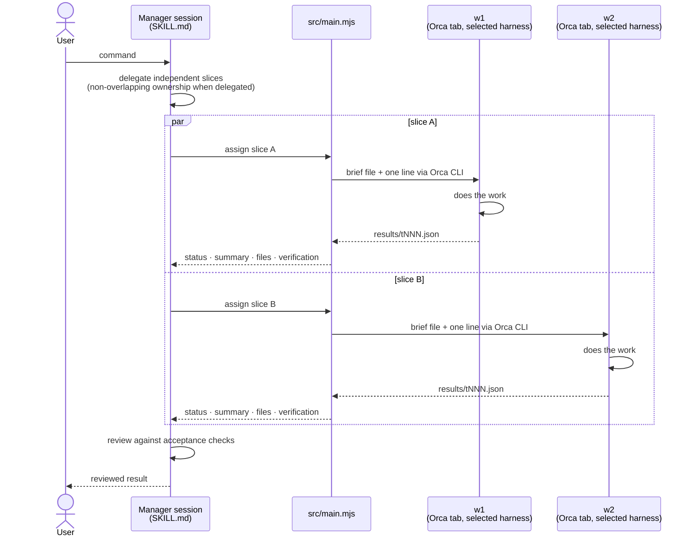

# team-building


Persistent AI-worker teams: the current session becomes a manager that splits work into slices and hands them to
persistent worker sessions (w1, w2, …). Each worker runs omp, Claude Code, or Codex in its own
[Orca](https://github.com/stablyai/orca) terminal and returns a result JSON. Usage and rules: [`SKILL.md`](SKILL.md).

## Concept



- Workers are persistent: each keeps its own harness session, so a follow-up to `wN` has earlier context.
- A worker pins its native session ID/file and Orca PTY/pane identity. Stale handles reconnect to that worker. Confirmed exit or model change uses an exact noninteractive resume, never another Orca tab or a latest-session selector. Unknown process state or missing/ambiguous session identity fails closed; `status` reports the session and transport.
- Every assignment returns `succeeded`, `failed` or `blocked`, including on timeout, a crash or a bad model.
  Workers never ask the user; they report `blocked` with the exact need.
- `team clear` collects a wrap-up from every worker, closes their terminals and writes one summary report.

- Shared cwd is the default. `team init --isolate` gives each worker an Orca worktree and requires a local commit for manager review/merge; each worktree has separate build caches (for example `target/` or `node_modules`), so cold builds and disk use increase.
- OMP dispatch defaults to `assign --difficulty simple|moderate|complex`: the manager classifies every brief locally and routes to Luna (`--thinking max`), Terra, or Sol. Omit a tier only for a fixed `init --model` team or a deliberate per-task `assign --model`; no classifier API call is used. Mixed-harness teams must select a known OMP worker before routing.
- Assignments use an idle timeout (default 1200 seconds) and absolute cap (default 14400 seconds). External commands are blocked pending an exact per-task approval.

## Requirements

- Node.js 20+ with npm, and Orca running with its CLI on `PATH` as `orca-ide` (tested with 1.4.197). Different name →
  `export ORCA_CLI_COMMAND=<cli>`. Never point it at bare `orca` on Linux (GNOME screen reader).
- OMP is the default worker harness. Claude Code and Codex are supported when explicitly selected with
  `--harness claude` or `--harness codex`; both require `--allow-bypass`.

## Install

Install with the [Skills CLI](https://github.com/vercel-labs/skills). The `cline` target is intentional: it bridges
the canonical skill to `~/.agents/skills`, the shared location OMP reads. Codex and Claude Code targets are installed
at the same time where supported. The second command installs the required Node dependencies:

```sh
npx --yes skills add DamChan0/team-building-skill --skill team-building --yes -g -a cline -a codex -a claude-code && \
  node ~/.agents/skills/team-building/install.mjs
```

If OMP is missing, setup still completes but prints the official Linux/macOS installation suggestion:

```sh
curl -fsSL https://omp.sh/install | sh
```

See <https://omp.sh/docs/quickstart>. Restart the manager harness, then say `team init` (or
`팀 만들어줘, 작업자 4명`). Use `team init --harness claude --allow-bypass` or
`--harness codex --allow-bypass` only when selecting those worker harnesses.

Update only this installed skill, then re-run dependency setup:

```sh
npx --yes skills update team-building --global --yes && \
  node ~/.agents/skills/team-building/install.mjs
```

Uninstall: run `team clear` first, then `npx skills remove -g team-building`.

## Files written at runtime

- `~/.local/state/team-building/<team-id>/` — team state, briefs, results, worker sessions (deleted by `clear`)
- `~/work-notes/team-building/<date>-<team-id>.md` — wrap-up report written by `clear`
