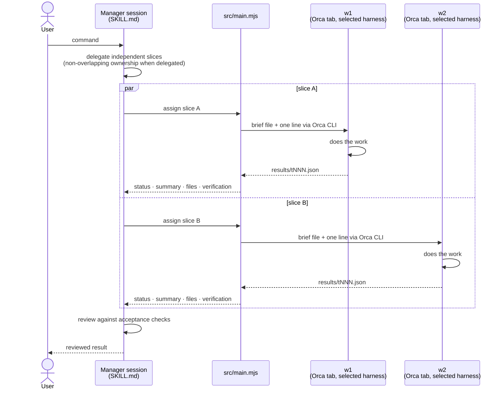

# team-building

Release: [v0.1.0](https://github.com/DamChan0/team-building-skill/releases/tag/v0.1.0).


Persistent AI-worker teams: the current session becomes a manager that splits work into slices and hands them to
persistent worker sessions (w1, w2, …). Each worker runs omp, Claude Code, or Codex in its own
[Orca](https://github.com/stablyai/orca) terminal and returns a result JSON. Usage and rules: [`SKILL.md`](SKILL.md).

## Concept



- Workers are persistent: each keeps its own harness session, so a follow-up to `wN` has earlier context.
- A worker pins its native session ID/file and Orca PTY/pane identity. Stale handles reconnect to that worker. Confirmed exit or model change uses an exact noninteractive resume, never another Orca tab or a latest-session selector. Unknown process state or missing/ambiguous session identity fails closed; `status` reports the session and transport.
- Every assignment returns `succeeded`, `failed` or `blocked`, including on timeout, a crash or a bad model.
  Workers never ask the user; they report `blocked` with the exact need.
- `team clear` collects a wrap-up from every worker, closes their terminals and writes one summary report.

- Shared cwd is the default. `team init --isolate` gives each worker an Orca worktree and requires a local commit for manager review/merge; each worktree has separate build caches (for example `target/` or `node_modules`), so cold builds and disk use increase.
- OMP teams route automatically after `init`: plain `init` or `init gpt` selects GPT; `init claude` (also `init --model claude`) selects the Claude model family, not the native Claude Code harness. Claude workers start with a Sonnet baseline for simple/moderate work; complex assignments upgrade only the selected worker's same session to Opus. The next ordinary assignment returns that session to Sonnet. Haiku is only the lightweight classifier. Init refreshes and saves OMP's catalog; `assign --difficulty` selects a saved tier without classification, and `assign --model` overrides one task. Fixed exact-model and native Claude Code/Codex teams do not auto-route.
- Assignments use an idle timeout (default 1200 seconds) and absolute cap (default 14400 seconds). External commands are blocked pending an exact per-task approval.

## Requirements

- Node.js 20+ with npm, and Orca running with its CLI on `PATH` as `orca-ide` (tested with 1.4.197). Different name →
  `export ORCA_CLI_COMMAND=<cli>`. Never point it at bare `orca` on Linux (GNOME screen reader).
- OMP is the default worker harness. Claude Code and Codex are supported when explicitly selected with
  `--harness claude` or `--harness codex`; both require `--allow-bypass`.

## Install

Install with the [Skills CLI](https://github.com/vercel-labs/skills). The `cline` target is intentional: it bridges
the canonical skill to `~/.agents/skills`, the shared location OMP reads. Codex and Claude Code targets are installed
at the same time where supported. The second command installs the required Node dependencies:

```sh
npx --yes skills add DamChan0/team-building-skill --skill team-building --yes -g -a cline -a codex -a claude-code && \
  node ~/.agents/skills/team-building/install.mjs
```

Setup also adds OMP's `/team-building` command with inline parameter examples. Type `/team-building ` to see the hint, for example `init claude --member 3`. Claude Code uses the skill's `argument-hint`; OMP's `/skill:team-building` picker shows examples in its description instead.

If OMP is missing, setup still completes but prints the official Linux/macOS installation suggestion:

```sh
curl -fsSL https://omp.sh/install | sh
```

See <https://omp.sh/docs/quickstart>. Restart the manager harness, then say `team init` (or
`팀 만들어줘, 작업자 4명`). Use `team init --harness claude --allow-bypass` or
`--harness codex --allow-bypass` only when selecting those worker harnesses.

## Routing an OMP team

```sh
# Refresh and pin the current GPT catalog, then let assignment route the original brief.
node ~/.agents/skills/team-building/src/main.mjs init --member 3
node ~/.agents/skills/team-building/src/main.mjs assign "Fix the failing parser test."

# Or pin the current Claude-family catalog for this OMP team.
node ~/.agents/skills/team-building/src/main.mjs init claude --member 3
node ~/.agents/skills/team-building/src/main.mjs assign "Review this concurrent cache change."
```

GPT tiers: **simple** Luna Max, **moderate** Terra, **complex** Sol, **extreme** Astra. Claude tiers: **simple/moderate** Sonnet, **complex** Opus, **extreme** the same latest Opus with explicit `thinking=xhigh`; Haiku classifies only. Astra has no explicit thinking override. Opus must support xhigh or initialization fails rather than downgrades. Existing three-tier teams must rerun `init` to acquire extreme.

When an OMP session resumes without a task-specific effort override, the helper explicitly reapplies `defaultThinkingLevel`; an earlier extreme task's saved `xhigh` cannot leak into ordinary work.

The saved map is deliberately stable for a team: run `init` again to refresh it. Use
`assign --difficulty simple|moderate|complex|extreme` when you already know the tier, or
`assign --model <selector>` for an exact one-task override. `init --model <exact selector>`
creates a fixed-model team instead; it does not auto-route.

The Claude family keeps the native session ID/file across model changes; it never creates another Orca tab to upgrade a task. `--harness claude --allow-bypass` explicitly selects the native Claude Code CLI instead of OMP family routing.

Update only this installed skill, then re-run dependency setup:

```sh
npx --yes skills update team-building --global --yes && \
  node ~/.agents/skills/team-building/install.mjs
```

Uninstall: run `team clear` first, then `npx skills remove -g team-building`. If setup installed the generated OMP alias, remove `team-building.md` from the commands directory reported by setup as well; leave user-owned conflicting aliases unchanged.

## Files written at runtime

- `~/.local/state/team-building/<team-id>/` — team state, briefs, results, worker sessions (deleted by `clear`)
- `~/work-notes/team-building/<date>-<team-id>.md` — wrap-up report written by `clear`
- `~/.omp/agent/commands/team-building.md` — generated parameter-hint command installed by setup; `PI_CONFIG_DIR` and `OMP_PROFILE`/`PI_PROFILE` select its config/profile directory
