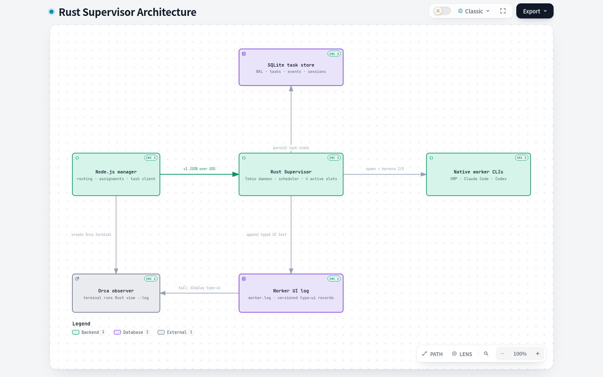
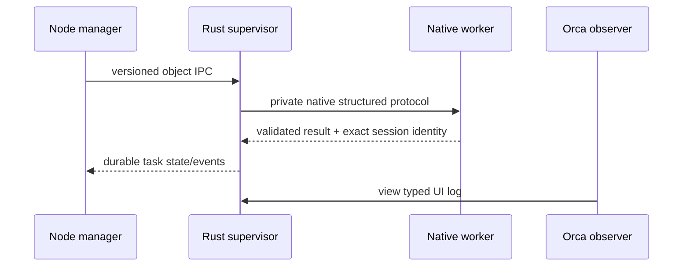

# team-building

- **Release:** [v0.5.4](https://github.com/DamChan0/team-building-skill/releases/tag/v0.5.4)
- Persistent AI-worker teams managed from one session.
- **Manager hosts:** OMP, Pi, Claude Code, and Codex. The `SKILL.md` uses the Agent Skills format supported by [Claude Code](https://code.claude.com/docs/en/skills) and [Codex](https://developers.openai.com/codex/skills).
- **OMP is not needed when Pi, Claude Code, or Codex is the manager and you select native workers.** OMP remains the default worker backend.
- **A terminal multiplexer is required in every mode:** Orca (app and CLI with the active worktree registered) or herdr (manager running inside a herdr pane).


## Weight routing

`SKILL.md` makes the manager pick the lightest executor first: tier 0 inline, tier 1 one-shot host subagent (no team), tier 2 a 1–2 worker team, tier 3 a parallel team sized to the independent slices (≤4). Failed or blocked results escalate one tier; idle workers are dismissed. `--difficulty` chooses model strength independently of team size.

## Execution model


[Interactive, source-linked diagram](.archify/architecture-rust-supervisor-20261013-180850/rust-supervisor.html) · [Editable Archify candidate](.archify/architecture-rust-supervisor-20261013-180850/candidate.json).



- **Manager:** Node.js handles team metadata, model routing, and task submission.
- **Supervisor:** one Rust process owns native worker processes, scheduling, sessions, and durable task state.
- **Worker backends:**
  - `omp` (default) runs the worker as a live interactive OMP session in its Orca tab. The `team-role` extension inside that session exchanges task/result files with the supervisor (`<team-dir>/tabs/<worker>/`: `ready.json`, `beat`, `task.json`, `started.json`, `outcome.json`, `abort.json`), so you can watch and type into the worker while the manager's `assign` still blocks for the structured result.
  - `claude` launches the native Claude Code CLI with `stream-json`.
  - `codex` launches the native Codex CLI through `app-server` JSON-RPC.
- **Terminal/worktree backend:** Orca by default, herdr when the manager runs inside a herdr pane (`HERDR_ENV=1`). A team stays bound to the backend it was created under (`team.json` `backend`; teams without it are Orca teams); commands from the other backend exit 4 and `status`/`init` list only this backend's teams. Under herdr the worker is a tab in the manager's workspace (label `<team-id> <worker-id> session`) whose pane runs the launch command via `<team-dir>/tabs/<worker>/launch.sh`; the tab id is the stored handle, a vanished tab means a closed worker tab, and calls are pinned to the herdr server recorded at init (`HERDR_SOCKET_PATH`). herdr worktrees (`--isolate`) keep their branch after removal.
- **Worker tabs:** An OMP worker's tab *is* the worker: the full interactive session, resumed from its recorded session file. Claude/Codex tabs are read-only observers showing one typed UI summary line per finished task and never receive native protocol traffic or `TaskResult` JSON.
- Closing an OMP worker tab ends that worker (a running task becomes `failed: worker tab exited`); the session file survives. The next assignment, `member <current N>`, or `init` re-adoption reopens the tab and resumes the same session. Closing a Claude/Codex observer does not stop its worker. Connected tabs are reused. A live Orca tab without a pane produces a warning instead of launching another; use `orca-ide terminal switch --terminal <handle>` to reveal it.
- Typing into an OMP worker tab while a task runs is allowed but unsupervised: its output is part of that task's final message. The extension needs `team-role.ts` installed (`node install.mjs`) before the tab starts, and omp tab titles are managed by omp itself (`<team-id> <worker-id> observer` applies only to Claude/Codex).
- **Temporary tool tabs:** The manager snapshots the team's tabs before each assignment. Workers report only disposable tab IDs they created in `tool_sessions`; after the result, the manager closes only tabs absent from that snapshot and refuses registered worker tabs or tabs outside the team's workspace. Existing manager/user tabs stay open. Workers close non-tab helper sessions through their owning tool. Cleanup failures appear as `tool_session_cleanup_errors`; detached tasks remain available for retry.
- **Local IPC:** every request uses an object envelope such as `{ "version": 1, "id": "<uuid>", "type": "<command>", "payload": { ... } }`.
  - Envelopes and payloads must be objects; scalar requests are rejected.
  - Responses and events are correlated objects.
- **Disconnects and retries:**
  - Manager EOF never cancels accepted work.
  - `running` records scheduler dispatch; `started` confirms native prompt acceptance. Integration fixtures wait for `started` before requesting completion.
  - Retrying the same `--request-id` with the identical assignment replays it; a changed assignment conflicts.
  - Queues are FIFO per worker.
- **Restart recovery:**
  - A running task becomes `unknown`, never a synthetic success or failure.
  - It stays fenced until the broker proves its recorded process group stopped.
  - Recovery blocks queued successors and preserves the exact native session.
- **Session resume:**
  - OMP requires its native session file.
  - Claude and Codex resume their exact broker-recorded IDs.
  - Never recover with `latest`, `continue`, or a fresh session.
- **Resource limits:** current-thread Tokio runtime; 32 IPC clients; 4 active workers; 1 MiB protocol frames; 1024 queued tasks; bounded, rotated worker logs; 512 KiB SQLite cache with mmap disabled.

## Requirements and installation

- **Setup prerequisites:** Node.js 20+, npm, Rust/Cargo.
- **Runtime prerequisites:**
  - Node.js 20+.
  - A running Orca app and CLI (`orca-ide`) with the current worktree registered, **or** a running herdr with the manager inside a herdr pane (`HERDR_ENV=1`).
  - The selected worker CLI in `PATH` (`omp`, `claude`, or `codex`).
- On Linux, do not use bare `orca`; it is the GNOME screen reader.
- Set `ORCA_CLI_COMMAND` if the Orca CLI binary has another name; `HERDR_CLI_COMMAND` likewise for herdr.
- **Install the skill for Claude Code and Codex** using the [Skills CLI](https://github.com/vercel-labs/skills):

  ```sh
  npx --yes skills add DamChan0/team-building-skill \
    --skill team-building --yes -g \
    -a codex -a claude-code && \
    node ~/.agents/skills/team-building/install.mjs
  ```

  - Claude Code can invoke `/team-building`; Codex can invoke `$team-building` or find it with `/skills`.
  - Start a new manager session after installation if the skill is not yet listed.
- **Update an existing global installation** and rebuild its runtime setup:

  ```sh
  npx --yes skills update team-building --global --yes && \
    node ~/.agents/skills/team-building/install.mjs
  ```

- **The setup script** installs Node dependencies and builds `supervisor/` with `cargo build --release --locked`.
  - The first supervisor use performs the same locked build if the binary is absent.
  - There is no Node transport fallback.
- OMP is not a hard install requirement. If it is missing, setup still installs the skill and prints the OMP install suggestion.
  - Setup also writes an OMP-specific `/team-building` command alias; Claude Code and Codex use the installed `SKILL.md` instead.
- When `pi` is on `PATH`, setup also installs a separate manager-role widget in `$PI_CODING_AGENT_DIR/extensions` (default `~/.pi/agent/extensions`). Pi is not an OMP worker-tab backend.
- **OMP backend only:** install OMP and set `tools.approvalMode=yolo`; workers cannot answer approval prompts.

  ```sh
  curl -fsSL https://omp.sh/install | sh
  ```

  - See the [OMP quickstart](https://omp.sh/docs/quickstart).


## OMP role badge

- Setup installs an OMP extension that shows a blue `🔧 Role: worker` badge for workers and a bold purple `👑 Role: manager` badge for the active manager session.
- `init` records the manager session, so only that session receives the manager badge for its active team at the current path.
- Restart OMP after installation before the extension loads.

## Choose a worker backend

- `init` defaults to OMP.
- Use `--harness claude` or `--harness codex` for native workers; those worker backends do not need the OMP binary. If OMP is the manager host, OMP is still needed to run that host.
- Native Claude workers require the `claude` CLI. Native Codex workers require the `codex` CLI.
- **Native permissions warning:** `--allow-bypass` is required.
  - Claude Code receives `--dangerously-skip-permissions`.
  - Codex runs with `approval_policy="never"` and `sandbox_mode="danger-full-access"`.
  - These settings disable the native approval/sandbox protections. Use only with trusted tasks and worktrees.
- **Routing distinction:**
  - `init claude` selects Claude models through OMP; it does not select the native Claude Code CLI.
  - Native Claude workers use `init --harness claude --allow-bypass`.
  - GPT/Claude family routing and `assign --difficulty` require OMP workers. Native workers do not use the OMP classifier.

```sh
# OMP workers (default)
node ~/.agents/skills/team-building/src/main.mjs init --member 3

# Native Claude Code workers; no OMP worker
node ~/.agents/skills/team-building/src/main.mjs init --harness claude --allow-bypass --member 3

# Native Codex workers; no OMP worker
node ~/.agents/skills/team-building/src/main.mjs init --harness codex --allow-bypass --member 3
```

## OMP model routing

- Pin the GPT-family map from OMP's cached model catalog (`omp models <provider>`; `omp models refresh` runs only when the cache lacks a role), then let the classifier route each brief:

  ```sh
  node ~/.agents/skills/team-building/src/main.mjs init --member 3
  node ~/.agents/skills/team-building/src/main.mjs assign "Fix the failing parser test"
  ```

- Select the Claude model family for an OMP team with `init claude`:

  ```sh
  node ~/.agents/skills/team-building/src/main.mjs init claude --member 3
  node ~/.agents/skills/team-building/src/main.mjs assign "Review this concurrent cache change"
  ```

- Plain `init` / `init gpt` selects the GPT family.
- An exact `init --model <selector>` creates a fixed-model team and disables automatic routing.
- **GPT tiers:** simple Luna Max, moderate Terra, complex Sol, extreme Astra.
- **Claude tiers:** simple/moderate Sonnet, complex Opus, extreme Opus with `thinking=xhigh`; Haiku is only the lightweight classifier.
- Initialization fails rather than downgrading if the required model or effort is unavailable.
- The saved model map stays stable until the next `init` adoption.
- `assign --difficulty simple|moderate|complex|extreme` uses a saved tier without classification; `assign --model <selector>` overrides the model for one task.
- **Classifier:** with `TYPESAFE_API_KEY` set (environment, or a `TYPESAFE_API_KEY=` line in `~/.env`), a TypeSafe Jev Choice picks the tier in ~0.2s instead of a ~5s `omp -p` call; the brief text is sent to `api.typesafe.ai`. HTTP, timeout (5s), or invalid-answer failures warn and fall back to the OMP classifier. `TYPESAFE_API_KEY=` (empty) disables Jev.
- Invalid classifier output, routing errors, or a changed map fail closed.
- OMP resume reapplies its configured `defaultThinkingLevel`; an earlier extreme task's `xhigh` cannot leak into ordinary work.

## Commands and recovery

```sh
node ~/.agents/skills/team-building/src/main.mjs init [gpt|claude] [--name NAME] [--team ID|NAME] [--member N] [--model M] [--harness omp|claude|codex] [--allow-bypass] [--isolate] [--clear-previous|--keep-previous]
node ~/.agents/skills/team-building/src/main.mjs member N [--model M] [--harness H] [--allow-bypass]
node ~/.agents/skills/team-building/src/main.mjs dismiss --worker wN[,wM...]
node ~/.agents/skills/team-building/src/main.mjs status [--team ID|NAME]
node ~/.agents/skills/team-building/src/main.mjs assign [--team ID|NAME] [--detach] [--worker wN] [--approval tNNN] [--request-id UUID] [--model M] [--difficulty TIER] PROMPT
node ~/.agents/skills/team-building/src/main.mjs wait [--task tNNN[,tMMM]] [--worker wN] [--all|--any] [--timeout S]
node ~/.agents/skills/team-building/src/main.mjs approve --worker wN --task tNNN -- COMMAND...
node ~/.agents/skills/team-building/src/main.mjs stop --worker wN [--team ID|NAME]
node ~/.agents/skills/team-building/src/main.mjs clear [--team ID|NAME] [--fast]
```

- Same-path teams: `init --name team1` and `init --name team2` create independent teams; repeat a name to adopt that team. Run `assign --team team1 "..."` or `assign --team team2 "..."` to choose one explicitly.
- Names are lowercase slugs (`a-z`, digits, `_`, `-`), unique among active teams on the current backend; values matching generated team IDs are reserved. Without `--team`, a command uses the current path only when exactly one team matches; otherwise it asks for a selector.
- Teams at other paths still require `--clear-previous` or `--keep-previous` before creating a new team.

- `--team` accepts the generated team ID or a name.
- `--timeout` is the idle timeout (default 1200 seconds); `--max` is the absolute cap (default 14400 seconds).
- A 60-second supervisor wait checkpoint is not a worker failure.
- Workers receive `PWD` matching their configured cwd; OMP also receives `--cwd` so launches from the home directory do not relocate to `/tmp`.
- Retry an interrupted submission with the same `--request-id` and identical assignment.
  - A changed prompt, team, worker, model, thinking, difficulty, or approval conflicts rather than rerouting.
  - `assign --approval tNNN` keeps the approved source task and worker bound in the PATH shim.
- `assign` blocks by default. `assign --detach` submits the durable task and prints only its task ID (`tNNN`) on stdout, so blocking bash can dispatch independent slices serially without parsing chatter.
- `wait` waits for detached tasks in the current team and prints one compact JSON result per completed task. It defaults to all selected work; use `--task t001,t002` and/or `--worker wN` to select, `--any` for the first completion (whose status controls the exit code), and `--all` to make the default explicit. `wait --all` with no filters waits for every detached task.
- A wait exits nonzero for failed, blocked, unknown, or timed-out work. Completed mappings are removed; unfinished mappings remain available for a later `wait`.
- **Recover an `unknown` worker:** run `stop --team <id> --worker wN`.
  - The broker verifies native process ownership, blocks queued tasks instead of replaying them, and preserves the exact session.
  - Resubmit follow-up work afterward.
  - A legacy live terminal has no broker-owned process identity and stays blocked.
  - Closing an Orca tab is not proof that its process stopped.

## Worktrees and permissions

- Shared teams bind to the active worktree (herdr: the git root of the manager's cwd).
  - Every assignment checks that the team worktree still matches and the selected worker's cwd stays inside it.
- `--isolate` creates a separate worktree per worker (Orca worktree or herdr worktree, per the team's multiplexer).
  - Uncommitted manager changes are not copied into isolated worktrees.
  - Review isolated commits in the manager worktree and merge or cherry-pick locally.
  - Workers never push.
- `clear` removes only clean, merged isolated worktrees; dirty or unmerged worktrees stay in place.
- **Gated external commands:** `git push`, `ssh`, `scp`, `rsync`, `sftp`, `gh`, and `docker push`, plus `TEAM_BUILDING_GATED_EXTRA`.
  - Approval is exact and bound to one worker and source task.
  - Even read-only `ssh` requires approval.
  - PATH shims deter mistakes, not malicious workers; absolute paths and harness-native remote tools can bypass them.

## Runtime files and uninstall

- `~/.local/state/team-building/<team-id>/` — team metadata, approvals, results, worker logs, and session references; `clear` removes this only after verified recovery or retirement.
- `~/.local/state/team-building/supervisor/` — singleton supervisor SQLite database and lock.
  - Tests own their temporary supervisor processes, request `shutdown`, and wait for exit before removing temporary state. Team cleanup does not shut down the shared production supervisor.
- `~/work-notes/team-building/<date>-<team-id>.md` — summary written by `clear`.
- `~/.omp/agent/commands/team-building.md` — generated OMP command alias. `PI_CONFIG_DIR` and `OMP_PROFILE`/`PI_PROFILE` select its config/profile directory. Setup leaves conflicting user-owned aliases unchanged.
- **Uninstall:** run `team clear` first, then `npx skills remove -g team-building`.
  - Remove the generated OMP alias from the commands directory reported by setup.
  - Leave user-owned aliases untouched.
