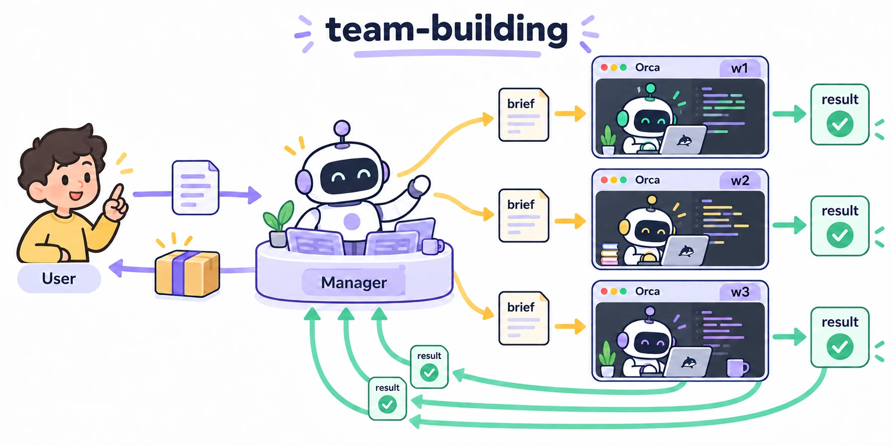
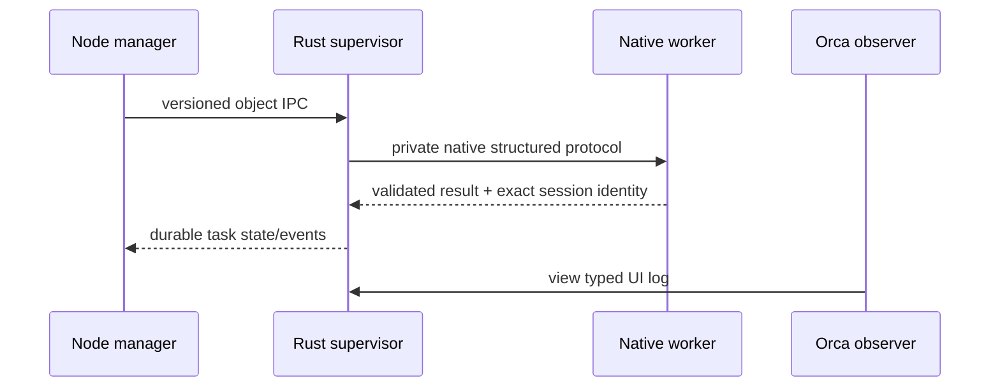

# team-building

Release: [v0.2.0](https://github.com/DamChan0/team-building-skill/releases/tag/v0.2.0).



Persistent AI-worker teams turn the current session into a manager that assigns slices to persistent OMP, Claude Code, or Codex sessions. Node manages team metadata and routing; a singleton Rust supervisor owns native processes, scheduling, sessions, and durable task state. Usage rules are in [`SKILL.md`](SKILL.md).

## Execution model



- Local IPC uses `{ "version": 1, "id": "<uuid>", "type": "<command>", "payload": { ... } }`. Every envelope and payload is an object; scalar requests are rejected. Responses and events are correlated objects.
- OMP RPC, Claude stream-json, and Codex app-server JSON-RPC remain private to the Rust worker. Orca terminals are read-only observers of typed UI messages; they never receive native protocol traffic or TaskResult JSON.
- A manager EOF never cancels work. Identical retries with the same `--request-id` replay the durable assignment; a changed assignment conflicts. FIFO queues are per worker.
- A restarted running task becomes `unknown`, never a synthetic success/failure. It stays fenced until the broker proves its recorded process group stopped. Recovery blocks queued successors and preserves the exact native session.
- Resume only the persisted identity. OMP requires its native session file; Claude and Codex resume their exact broker-recorded IDs. Never use `latest`, `continue`, or a fresh session as recovery.
- Resource bounds: current-thread Tokio runtime; at most 32 IPC clients and 4 active workers; 1 MiB protocol frames, 1024 queued tasks, bounded/rotated worker logs, SQLite cache 512 KiB with mmap disabled. The observer is the Rust binary, not a resident Node process.

## Requirements and install

Node.js 20+, npm, Rust/Cargo, OMP, and a running Orca CLI (`orca-ide`) are required. On Linux, do not use bare `orca`; it is the GNOME screen reader. Set `ORCA_CLI_COMMAND` if the CLI binary has another name. OMP is the default harness and requires `tools.approvalMode=yolo`. Native Claude Code and Codex require explicit `--allow-bypass`.

```sh
npx --yes skills add DamChan0/team-building-skill --skill team-building --yes -g -a cline -a codex -a claude-code && \
  node ~/.agents/skills/team-building/install.mjs
```

The setup script installs Node dependencies and builds `supervisor/` with `cargo build --release --locked`. The first supervisor use performs the same locked build if the binary is absent; there is no Node transport fallback. If OMP is missing, setup still installs the command and prints the official Linux/macOS suggestion:

```sh
curl -fsSL https://omp.sh/install | sh
```

See <https://omp.sh/docs/quickstart>. Restart the manager harness after installing the skill.

## Routing

```sh
# Refresh and pin the GPT-family map, then let the classifier route the brief.
node ~/.agents/skills/team-building/src/main.mjs init --member 3
node ~/.agents/skills/team-building/src/main.mjs assign "Fix the failing parser test"

# Or select the Claude model family for an OMP team.
node ~/.agents/skills/team-building/src/main.mjs init claude --member 3
node ~/.agents/skills/team-building/src/main.mjs assign "Review this concurrent cache change"
```

Plain `init` / `init gpt` selects the GPT family. `init claude` selects the Claude family for OMP; it does not select native Claude Code. Use `--harness claude --allow-bypass` for native Claude Code. An exact `init --model <selector>` creates a fixed-model team and disables automatic routing.

GPT tiers are simple Luna Max, moderate Terra, complex Sol, extreme Astra. Claude tiers are simple/moderate Sonnet, complex Opus, and extreme Opus with `thinking=xhigh`; Haiku is only the lightweight classifier. Initialization fails rather than downgrading if the required model/effort is unavailable. The saved map remains stable until the next `init` adoption. `assign --difficulty simple|moderate|complex|extreme` uses a saved tier without classification; `assign --model <selector>` is a per-task override. Invalid classifier output, routing errors, or a changed map fail closed.

OMP resumes without task-specific thinking by explicitly applying its configured `defaultThinkingLevel`; an earlier extreme task's `xhigh` cannot leak into ordinary work.

## Commands and recovery

```sh
node ~/.agents/skills/team-building/src/main.mjs init [gpt|claude] [--member N] [--model M] [--harness omp|claude|codex] [--allow-bypass] [--isolate] [--new]
node ~/.agents/skills/team-building/src/main.mjs member N [--model M] [--harness H] [--allow-bypass]
node ~/.agents/skills/team-building/src/main.mjs status [--team ID]
node ~/.agents/skills/team-building/src/main.mjs assign [--worker wN] [--approval tNNN] [--request-id UUID] [--model M] [--difficulty TIER] PROMPT
node ~/.agents/skills/team-building/src/main.mjs approve --worker wN --task tNNN -- COMMAND...
node ~/.agents/skills/team-building/src/main.mjs stop --worker wN [--team ID]
node ~/.agents/skills/team-building/src/main.mjs clear [--team ID]
```

An active team is adopted by `init`; `--new` forces a separate team. If multiple teams are active, pass `--team <id>`. `--timeout` is the idle timeout (default 1200 seconds); `--max` is the absolute cap (default 14400 seconds). A 60-second supervisor wait checkpoint is not a worker failure.

A request interrupted after submission can be retried with the same `--request-id` and identical assignment. A changed prompt, team, worker, model, thinking, difficulty, or approval conflicts rather than rerouting. `assign --approval tNNN` keeps the approved source task and worker bound in the PATH shim.

Recover a broker-owned `unknown` worker with `stop --team <id> --worker wN`. The command verifies native process ownership, blocks queued tasks rather than replaying them, and preserves the last exact session; resubmit follow-up work afterward. A legacy live terminal has no broker-owned process identity and remains blocked. Closing an Orca tab is not stop proof.

## Worktrees and permissions

Shared teams are bound to the active Orca worktree. Every assignment checks that the team worktree still matches and that the selected worker's cwd stays inside it. `--isolate` creates a separate Orca worktree per worker; uncommitted manager changes are not copied there. Review isolated commits in the manager worktree and merge/cherry-pick locally; workers never push. `clear` removes only clean merged isolated worktrees and leaves dirty/unmerged worktrees in place.

Gated external commands include `git push`, `ssh`, `scp`, `rsync`, `sftp`, `gh`, and `docker push` (plus `TEAM_BUILDING_GATED_EXTRA`). Approval is exact, per worker and source task; even read-only `ssh` needs approval. PATH shims deter mistakes, not malicious workers: absolute paths and harness-native remote tools can bypass them.

## Runtime files

- `~/.local/state/team-building/<team-id>/` — team metadata, approvals, results, worker logs, and session references; removed by `clear` only after verified recovery/retirement.
- `~/.local/state/team-building/supervisor/` — singleton supervisor SQLite database and lock.
- `~/work-notes/team-building/<date>-<team-id>.md` — summary written by `clear`.
- `~/.omp/agent/commands/team-building.md` — generated OMP command alias; `PI_CONFIG_DIR` and `OMP_PROFILE`/`PI_PROFILE` select its config/profile directory. Setup leaves conflicting user-owned aliases unchanged.

Uninstall: run `team clear` first, then `npx skills remove -g team-building`. Remove the generated OMP alias from the commands directory reported by setup; leave user-owned aliases untouched.
